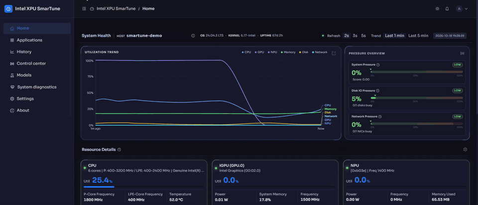
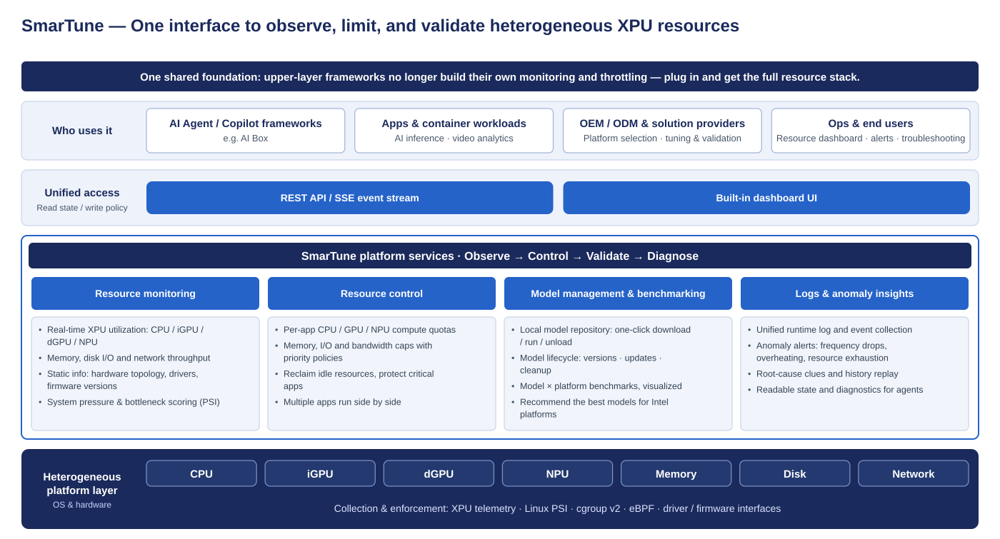

# Intel XPU SmarTune

## Demo



_A short walkthrough of the dashboard: live monitoring, resource control, and diagnostics._

📖 [User guide](docs/user-guide/getting-started.md)

## Overview

Intel XPU SmarTune is a collection of platform tools and services designed to
optimize and enhance the system operational efficiency of AI NAS. It brings
live monitoring, resource control, benchmarking, diagnostics, and history
together in a single browser dashboard.

An AI NAS often runs AI inference alongside media transcoding, backups, and
file sharing on the same hardware. When these workloads compete for CPU,
memory, or disk I/O, a heavy background job can slow down the apps users
actually care about. SmarTune measures that pressure, throttles the
lower-priority apps while it lasts, and gives the resources back as it eases —
without modifying or restarting the apps.



## Key Features

**Monitor**
- Live CPU, memory, disk, network, Intel GPU, and NPU usage in one dashboard
- A Pressure Overview panel with system, disk I/O, and network pressure, each rated low / medium / high / critical and naming the busy disks or NICs.
- Per-app and per-process resource use, plus long-term history trends and a hardware/software inventory

**Control**
- Under pressure, automatically limits CPU, memory, disk, and network for low-priority apps, and restores them step by step when it eases
- Priority classes keep critical apps running; new launches wait in a queue until resources free up
- Manual control when you want it: cap an app's CPU, memory, disk I/O, or network manually, restore limits immediately, and choose when auto-limiting takes over again.

**Benchmark**
- Download AI models and benchmark them on this machine (OpenVINO / GenAI)
- Compare runs side by side and see how load affects results

**Diagnostics**
- A timeline of what happened and what SmarTune did about it
- Alerts and plain-language advice, custom rules, and exportable reports

For how it works under the hood, see the [Balancer guide](docs/design/balancer.md)
and [Pressure algorithm](docs/design/pressure-algorithm.md).

## Quick Start (run from source)

**1. Start the backend** (from the repository root). On first run the script
creates a `.smartune-venv` virtual environment and installs `requirements.txt`
automatically:

```bash
bash start_smartune.sh        # balancer + monitor (port 9001)
# bash start_smartune.sh -m   # monitor only
```

**2. Start the frontend** in a second terminal:

```bash
cd dashboard
bash start_dashboard.sh       # dev server on port 39527
```

**3. Open the dashboard** in a browser, using the host machine's IP address:

```text
http://<host-ip>:39527/
```

Next: the **[User guide → Getting started](docs/user-guide/getting-started.md)**, or the
[Install guide](docs/install.md) for the systemd service, the Debian package, and
building native dependencies.

## Install

See the **[Install guide](docs/install.md)** — run from source (optionally as a systemd service) or install the Debian package, plus verified platforms and ports.

## Documentation

Full index: **[docs/](docs/README.md)**

- **[User guide](docs/user-guide/getting-started.md)** — using each dashboard tab, workflows, troubleshooting
- **[Install](docs/install.md)** — from source, systemd, Debian package
- **[API reference](docs/reference/api.md)** — REST endpoints ([benchmark](benchmark/API_benchmark.md), [diagnostics](diagnostics/API_diagnostics.md))
- **[Design & internals](docs/design/architecture.md)** — [architecture](docs/design/architecture.md), [balancer](docs/design/balancer.md), [pressure algorithm](docs/design/pressure-algorithm.md)

## Contributing & Security

- [Contributing guidelines](CONTRIBUTING.md)
- [Code of conduct](CODE_OF_CONDUCT.md)
- [Security policy](SECURITY.md)

## License

Each component of the Edge Infrastructure external is licensed under [Apache 2.0][apache-license].

[apache-license]: https://www.apache.org/licenses/LICENSE-2.0
