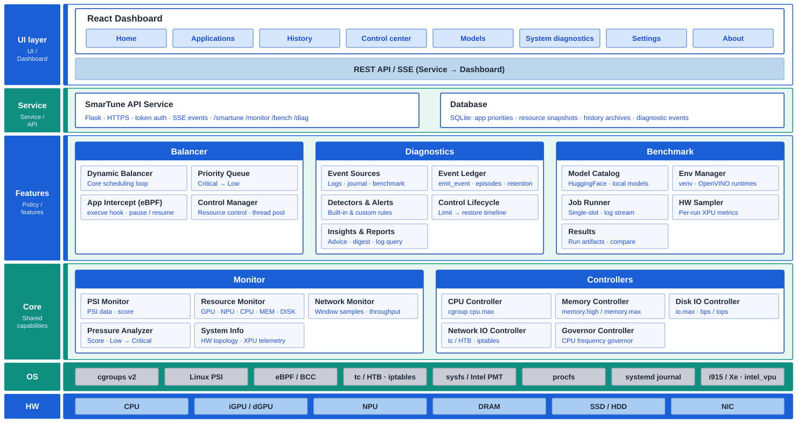

# Architecture & repository layout

How SmarTune is put together, and where each piece lives in the source tree.



Each layer uses only the layers below it. Within the Features layer:

| Module | Depends on |
|---|---|
| Balancer | Monitor (pressure, usage, cgroup stats), Controllers |
| Benchmark | Monitor (hardware sampling during runs) |
| Diagnostics | Monitor (system info, snapshots), Benchmark (results, job state) |

Monitor and Balancer report events to Diagnostics only through `emit_event()`,
a best-effort seam that is a no-op when diagnostics is not installed.

The monitor and the shared layers (config/utils/db) live at the repository root
so the monitor can run independently of the balancer. `balancer/` holds only the
balancer-specific source and cannot run on its own without the monitor.

```
intel-xpu-smartune/
├── smartune.py                 # Single entry point: -a (balancer + monitor) / -m (monitor only)
├── start_smartune.sh           # Start script: -a (default, all) / -m (monitor only)
├── start_smartune_service.sh   # systemd entry script (cert-gen + launch, no sudo/trap)
├── smartune.service            # systemd unit template
├── smartune_api.py             # Shared API for both services (incl. app-wide auth-token gate)
├── features.py                 # Mounts benchmark/, diagnostics/ and dashboard/dist when present
├── my_database.db              # Peewee SQLite DB (generated at runtime)
├── key/                        # Generated TLS certificate/key (b_server.crt / .key)
├── logs/                       # Runtime logs
├── docs/                       # User guide, install, reference, design notes (see docs/README.md)
├── config/                     # config.yaml (thresholds, weights, app list) and config loader
├── utils/                      # Shared utilities: logger, app_utils, http_utils, quiet_mode, ui_lease
├── db/                         # Peewee ORM database model for controlled app records
├── monitor/                    # System monitoring components (runs standalone):
│   ├── monitor_service.py      #   Standalone monitor entry point (own Flask app, port 9001)
│   ├── monitor_api.py          #   Flask Blueprint exposing /monitor/* REST endpoints
│   ├── psi.py                  #   Linux PSI reader
│   ├── pressure.py             #   Pressure scoring and level classification
│   ├── disk_pressure.py        #   Per-disk I/O pressure
│   ├── network.py              #   Network traffic sampling and pressure calculation
│   ├── res_monitor.py          #   CPU/memory/disk/network resource usage and top-process finder
│   ├── cgroup.py               #   cgroup path resolution and monitoring
│   ├── app_discovery.py        #   "Add App" wizard: process search and field extraction
│   ├── gpu_monitor.py          #   Intel GPU monitoring (i915/Xe PMU, RAPL, fdinfo)
│   ├── npu_monitor.py          #   Intel NPU monitoring via PMT telemetry and fdinfo
│   ├── system_info.py          #   Static/dynamic hardware & software info collection
│   └── metrics/                #   Per-subsystem metric collectors (cpu, memory, gpu, npu, history, ...)
├── benchmark/                  # Benchmark backend: /bench/* API, model download, job runner, sampler
├── diagnostics/                # System diagnostics: /diag/* API, event ledger, alerts, insights,
│                               #   log sources (SmarTune logs, journald, benchmark), redaction
├── dashboard/                  # React/TypeScript dashboard (multi-tab UI: Home, Applications,
│                               #   History, Control center, Models, System diagnostics, Settings, About)
├── packaging/deb/              # Monitor-only .deb build
└── balancer/                   # Balancer-specific source (not standalone-runnable):
    ├── balance_service.py        #   Flask REST API server; resource-balancing entry point
    ├── balancer/                #   Core balancing logic: DynamicBalancer, MaxPriorityQueue,
    │                            #     monitor-resource loop, network controller integration
    ├── controller/              #   Resource controllers:
    │   ├── control_manager.py   #     Pressure monitor + controllers; memory-reclaim ladder
    │   ├── cpu.py               #     CPU quota (cgroups v2 cpu.max)
    │   ├── memory.py            #     Memory limits (memory.high / memory.max)
    │   ├── swap.py              #     Swap headroom for memory reclaim
    │   ├── io.py                #     Disk I/O throttling (io.max rbps/wbps/riops/wiops)
    │   ├── network.py           #     Network traffic shaping (tc/HTB + iptables + cgroup)
    │   ├── governor.py          #     CPU frequency governor switching
    │   ├── process_control.py   #     Kill / suspend / resume a process
    │   ├── psi.py               #     PSI trigger-based resource reader
    │   ├── app_intercept.py     #     eBPF-based app launch/exit detection (BCC)
    │   └── bpf_event.c          #     eBPF C program for execve/exit tracepoints
    └── test/                    #   Feature test scripts (BPF, PSI, disk I/O, reclaim, notifications)
```

