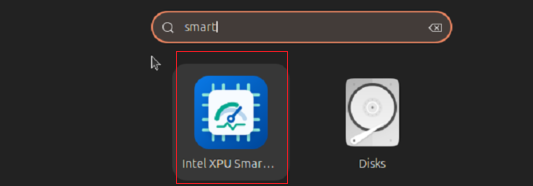
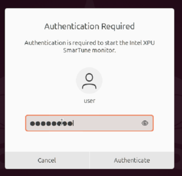
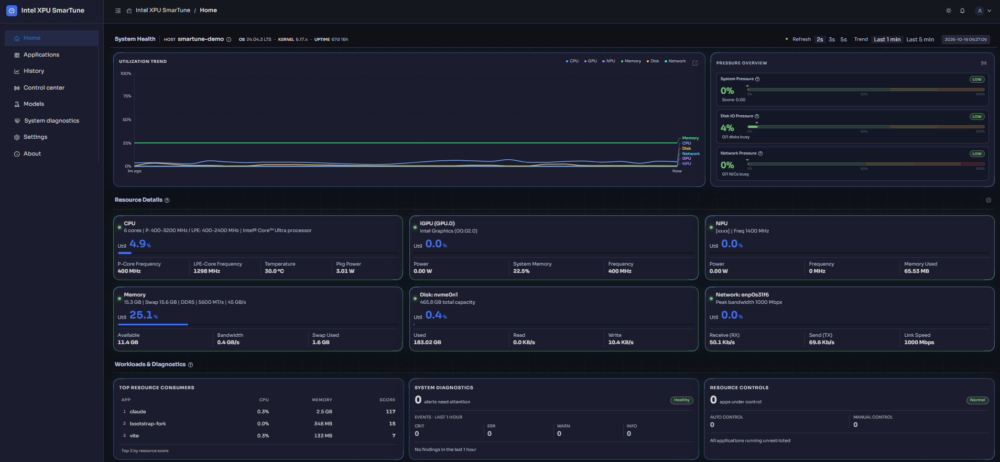

# Install

Three ways to run SmarTune — pick **one**:

| Method | Best for | Dashboard URL |
| --- | --- | --- |
| [Run from source](#run-from-source) — start the backend by hand | Development, a quick trial | `http://<host-ip>:39527/` (dev server) |
| [Run from source as a systemd service](#run-as-a-systemd-service) | A long-running source install that starts on boot and restarts on failure | `http://<host-ip>:39527/` (dev server) |
| [Debian package](#debian-package) | End users: self-contained, bundled venv, built dashboard | `https://localhost:9001` |

**Verified platforms:** Intel MTL, PTL, and Wildcat Lake on Ubuntu / Debian
(the Debian package targets Ubuntu 24.04, Python 3.12). A local administrator
account is required: SmarTune needs root to read hardware telemetry and apply
cgroup limits.

**Ports.** From source, the backend listens on **9001** and the dashboard dev
server on **39527**. With the Debian package the backend serves the built
dashboard itself at `https://localhost:9001`.

---

## Run from source

### 1. Install dependencies

**Python packages** (always required), from the repository root:

```bash
sudo pip install -r requirements.txt --break-system-packages
```

> If pip complains it "Cannot uninstall blinker...", add `--ignore-installed blinker`.

**Native dependencies** (balancer / resource control only). Monitor-only mode
(`-m`) needs nothing more. The balancer relies on these native tools, which a
default Ubuntu install already provides — install them only on a minimal or
non-standard system:

- `python3-bpfcc` — the BCC/eBPF Python binding used to detect app launches/exits.
- `linux-headers-$(uname -r)` — needed so eBPF programs compile at runtime.
- `cpupower` — CPU frequency governor switching.
- `iproute2`, `iptables`, `iotop`, `kmod` — network/IO control helpers.

If `python3-bpfcc` or `cpupower` has no prebuilt package on your platform, see
the [appendix](#appendix-building-native-dependencies-from-source).

### 2. Run the backend

All commands run from the repository root. TLS certs are auto-generated under
`key/`, logs are written under `logs/`, and `my_database.db` is created at the
repository root.

```bash
bash start_smartune.sh        # -a (default): balancer + monitor, single process, port 9001
bash start_smartune.sh -m     # monitor only (standalone telemetry), port 9001
```

Both modes listen on port 9001; the dashboard auto-adapts to a monitor-only
server via `/smartune/capabilities`.

### 3. Run the dashboard dev server

Node.js 20.19+ is required; the script auto-installs/upgrades it on
Ubuntu/Debian if missing or outdated. Run it in a second terminal:

```bash
cd dashboard
bash start_dashboard.sh    # dev server on port 39527, binds 0.0.0.0
```

Open `http://<host-ip>:39527/` (or `http://localhost:39527/` on the host
itself). The dev server proxies API calls to the backend on port 9001.

---

## Run as a systemd service

Runs the source checkout as a managed service that starts on boot and restarts
on failure. Complete [step 1](#1-install-dependencies) of *Run from source*
first; the service replaces step 2, and the dashboard still comes from the
[dev server](#3-run-the-dashboard-dev-server).

```bash
# 1. Make sure the logs dir exists:
mkdir -p logs

# 2. Install the unit file (path filled automatically from $(pwd)):
sed "s#__SMARTUNE_ROOT__#$(pwd)#g" smartune.service | sudo tee /etc/systemd/system/smartune.service
sudo systemctl daemon-reload

# 3. Enable on boot and start the service:
sudo systemctl enable --now smartune.service

# 4. Check status / logs:
sudo systemctl status smartune.service
tail -f logs/smartune.log

# 5. Stop / disable / uninstall, if needed:
sudo systemctl disable --now smartune.service
sudo rm /etc/systemd/system/smartune.service
sudo systemctl daemon-reload
```

---

## Debian package

Two mutually exclusive packages — install **one**:

| Package | Contents | Service runs | Tabs you get |
| --- | --- | --- | --- |
| `smartune-monitor` | Monitor only (telemetry + system-pressure dashboard) | `smartune.py -m` | Home, Applications, History, Settings, About |
| `smartune` | **Full**: balancer **and** monitor | `smartune.py -a` | all of the above **plus** Control center (and Models / System diagnostics when enabled) |

`smartune` supersedes `smartune-monitor` (it declares `Conflicts/Replaces/Provides`),
so installing one automatically replaces the other. Both install to
`/opt/intel/smartune` and register the **same** `smartune-monitor.service`.

The full package additionally needs the balancer's native dependencies, which
`apt install` pulls automatically (so it needs apt repository access at install
time). The balancer compiles eBPF programs **at runtime**, so a matching
`linux-headers-<version>` for your running kernel must also be present
(`linux-headers-generic` is recommended). If `cpupower` is unavailable on your
release, install `linux-tools-generic` instead.

### Build

The `.deb` isn't shipped ready-made; build it from the repository root. The build
host needs `dpkg-deb`, `git`, Python 3 with `pip`, network access to the Python
package index, and Node.js 20.19+ with `npm` when the dashboard is built. Pinned
pip dependencies are bundled into the package as offline wheels.

```bash
packaging/deb/build_deb.sh [VERSION] [OPTIONS]
```

`VERSION` defaults to `1.5.0`. Options:

- `--full` (alias `--all`): build the full `smartune` package; the default is monitor-only.
- `--skip-ui`: reuse `dashboard/dist` instead of rebuilding the dashboard (it is built anyway if `dashboard/dist/index.html` is missing).
- `-h`, `--help`: show usage.

```bash
packaging/deb/build_deb.sh                    # -> build/smartune-monitor_<ver>_amd64.deb
packaging/deb/build_deb.sh 1.5.1 --full       # -> build/smartune_1.5.1_amd64.deb
```

To make the result independent of your host's installed packages, build inside a
clean Ubuntu 26.04 container with
`bash packaging/deb/build_deb_withdocker_26.04.sh [--full]`.

### Install

```bash
sudo apt install ./build/smartune-monitor_*.deb    # monitor only
sudo apt install ./build/smartune_*.deb            # full (balancer + monitor)
```

Use `apt install` rather than `dpkg -i` so system dependencies are resolved.
The installation also adds the **Intel XPU SmarTune Monitor** application
launcher (plus a desktop shortcut when supported) and `smartune-monitor.service`.
The service is not enabled at boot; the launcher starts it on demand via
`pkexec systemctl start smartune-monitor.service`.

### Launch

1. Open the application menu, search for `Intel XPU` or `SmarTune`, and select
   **Intel XPU SmarTune Monitor**.

   

2. Starting the service needs administrator privileges, so a Polkit dialog
   appears. Enter your administrator password and select **Authenticate**. If you
   cancel, the service does not start and the dashboard does not open.

   

3. The browser opens the dashboard at `https://localhost:9001`. It may show
   **Not Secure** because the dashboard uses a self-signed TLS certificate;
   confirm the address is `localhost:9001` and continue.

   

### Service and troubleshooting

```bash
systemctl status smartune-monitor.service
sudo journalctl -u smartune-monitor.service -b --no-pager
sudo systemctl start smartune-monitor.service       # or: stop
curl -k -I https://localhost:9001/
```

- **No authentication dialog:** log out of the desktop session and back in;
  closing the window or locking the screen does not restart the Polkit agent.
- **Python version mismatch at install:** check `cat /etc/os-release` and
  `python3 --version`. The Ubuntu 24.04 package expects Python 3.12 — do not
  install it on an older release.

### Uninstall

Use the package name you installed (`smartune-monitor` or `smartune`):

```bash
sudo apt remove smartune-monitor    # keep config files
sudo apt purge smartune-monitor     # also remove package-managed config
```

---

## Appendix: Building native dependencies from source

You only need this appendix if you're **not** on a supported Ubuntu / Debian
release with prebuilt packages. On those, [the dependency step](#1-install-dependencies)
(`pip install -r requirements.txt`) is enough — skip this appendix.

If `python3-bpfcc` and `cpupower` aren't packaged, build them from source
(below). Also make sure the kernel exposes its headers for runtime eBPF; see
[Missing kernel headers](#missing-kernel-headers-kheaders).

### Build bcc (if `python3-bpfcc` is unavailable)

Refer to the [bcc install guide](https://github.com/iovisor/bcc/blob/master/INSTALL.md#ubuntu---binary)
for background; the short version:

```bash
sudo apt install -y zip bison build-essential cmake flex git libedit-dev \
    libllvm14 llvm-14-dev libclang-14-dev python3 zlib1g-dev libelf-dev \
    libfl-dev python3-setuptools liblzma-dev libdebuginfod-dev \
    arping netperf iperf

git clone https://github.com/iovisor/bcc.git
mkdir bcc/build; cd bcc/build
cmake ..
make
sudo make install
cmake -DPYTHON_CMD=python3 ..   # build the python3 binding
pushd src/python/
make
sudo make install
popd
```

### Build cpupower (if the `cpupower` package is unavailable)

Check out the kernel tree matching your running kernel and build only the
`cpupower` tool:

```bash
git clone https://git.kernel.org/pub/scm/linux/kernel/git/stable/linux.git
cd linux
git checkout v6.12.41   # align to your kernel version
cd tools/power/cpupower
sudo apt install libpci-dev gettext
make
sudo make install
```

### Build libcgroup (only if a tool you add needs its Python binding)

The core services read cgroup v2 `io.stat` directly, so this is not required for
a normal run. Build it only if you add tooling that imports the libcgroup Python
binding:

```bash
pip install Cython
sudo apt install libpam-dev flex bison libsystemd-dev cmake build-essential \
    autoconf automake libtool m4 linux-tools-common cpufrequtils
git clone https://github.com/libcgroup/libcgroup.git
cd libcgroup
git checkout v3.2.0 -b v3.2.0
./bootstrap.sh
make
cd src/python
export VERSION_RELEASE="3.2.0"
python setup.py bdist_wheel
pip install dist/libcgroup-3.2.0-cp312-cp312-linux_x86_64.whl
```

### Missing kernel headers (`kheaders`)

Runtime eBPF compilation needs kernel headers for the running kernel. If
`modprobe kheaders` fails with "Module kheaders not found", either re-compile the
kernel with `CONFIG_IKHEADERS=m`, or, if you have a prebuilt `kheaders.ko`:

```bash
mkdir -p /lib/modules/$(uname -r)/kernel/kernel/
cp kheaders.ko /lib/modules/$(uname -r)/kernel/kernel/
depmod -a
modprobe kheaders
```

---

Next: the **[User guide](user-guide/getting-started.md)** for using the dashboard
once it's running.
