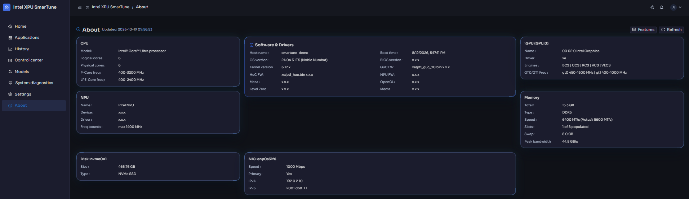

# About

[← Back to contents](../README.md)

**Purpose:** a complete, static inventory of the hardware and software on this
platform — the ground truth you need when reporting an issue, comparing
machines, or confirming firmware/driver versions.

<!-- Screenshot: the About tab showing the hardware/software inventory. -->

## What's listed

**Hardware**

- **CPU** — model, P-core / E-core topology, and frequency ranges.
- **Memory** — total capacity, DDR speed, and channel/slot configuration.
- **Disks** — device list and capacities.
- **Network** — interfaces, the primary NIC, link speeds, and IP addresses.
- **GPU** — per card: name, engine list, EU count, PCIe speed/width, PCI
  address, and frequency ranges.
- **NPU** — PCI ID, driver version, firmware version, and frequency ranges.

**Software / firmware**

- OS version, BIOS, and kernel.
- GPU GuC / HuC firmware, NPU firmware.
- Graphics stack: Mesa, OpenCL, Level Zero, and Media driver versions.

## SmarTune features

This tab also includes a **SmarTune Features** summary describing the
capabilities of the running build — a quick way to confirm whether control,
benchmarking, or diagnostics are enabled on this install.

---

That's the full dashboard tour. For end-to-end tasks, see
**[Common workflows](workflows.md)**.
