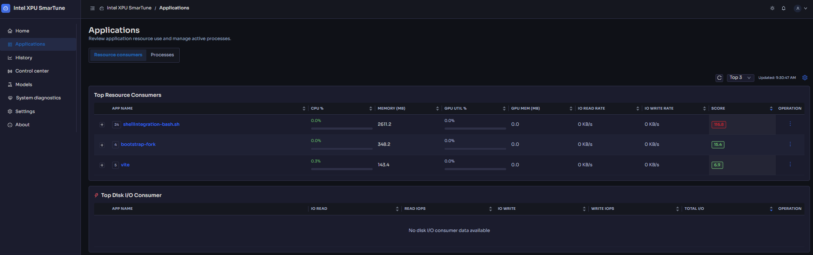
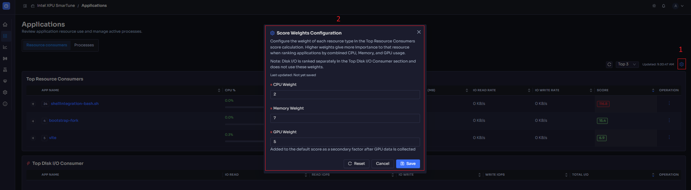
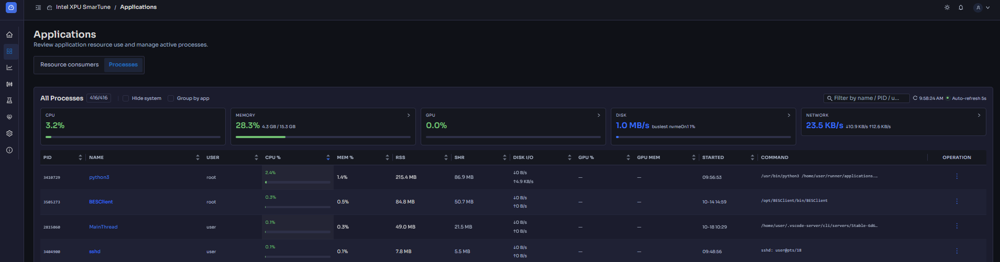
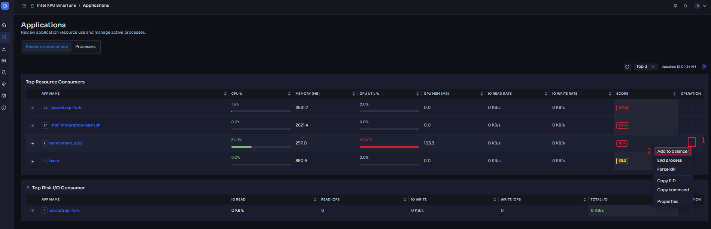

# Applications

[← Back to contents](../README.md)

**Purpose:** see the applications and processes running on the platform, how
much they consume, and bring the ones that matter under SmarTune's control.

The tab has two sub-views, switchable at the top:

- **Resource consumers** — the *controlled* apps SmarTune knows about, ranked by
  resource use.
- **Processes** — *every* process on the system, searchable, with per-process
  actions.

<!-- Screenshot: the Applications tab with the Resource consumers / Processes
     sub-view switch visible. -->

## Resource consumers

This view lists the apps SmarTune is managing and scores them by resource usage
so the heaviest rise to the top. For each app you see its CPU, memory, GPU and
I/O usage and its current priority/limit status.

<!-- Screenshot: the Resource consumers list with a few controlled apps. -->

**Configure Score Weights.** The ranking is a weighted score. Use the
**Configure Score Weights** control to set the **CPU Weight**, **Memory
Weight**, and **GPU Weight** so the ordering reflects what you care about on this
box (for example, weight GPU higher on an inference server).

Use **Manual refresh** to force an immediate update instead of waiting for the
next poll.

To change an app's priority or resource limits, use the
[Control center](control-center.md).

## Processes

This view is the full process table — useful for finding a workload that isn't
controlled yet. Use the search box to **filter by name, PID, user, or command
line**. Columns include CPU, memory, and per-GPU utilization.

<!-- Screenshot: the Processes sub-view with the search/filter box and the
     per-row action menu open. -->

Each row has an action menu to:

- **Add to balancer** — start controlling this workload (opens the Add
  Application wizard, below).
- **Process actions** — operational actions on the running process.

## Add an application to be controlled

When you want SmarTune to manage an app, add it via the **Add Application
wizard** (from a process row's *Add to balancer*, or from the
[Control center](control-center.md)).

<!-- Screenshot: the Add Application wizard, first step. -->

At a high level the wizard asks for:

1. **Display name** — the label shown in the controlled-apps table.
2. **Which processes belong to this app** — the program / executable basenames
   that identify it, so SmarTune can match current and future instances.
3. **Notes / scope** (optional) — a free-text note, e.g. *"dev workstation
   only"*.

Once added, the app appears under **Resource consumers** and becomes a target in
the [Control center](control-center.md), where you set its priority and limits.

**Editing later.** You can revise which processes map to an app at any time via
the **Edit processes** action — useful when an app spawns new helper binaries.

---

Next: **[Control center](control-center.md)** — set priority, apply limits, and
keep critical apps alive.
