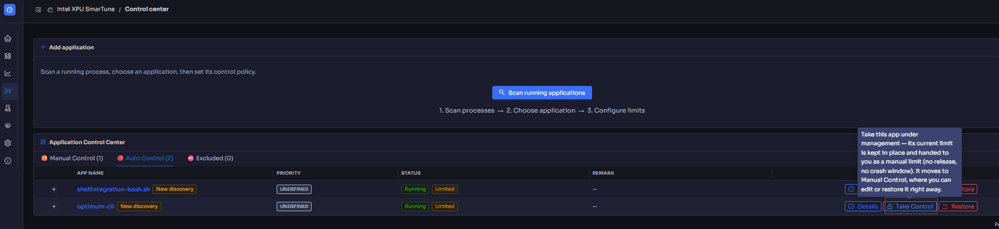
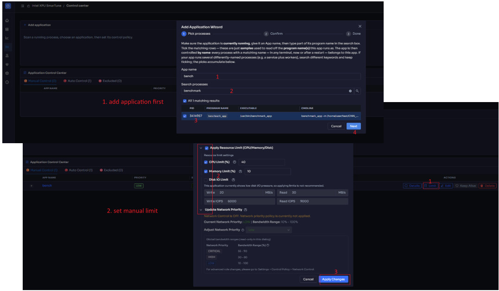
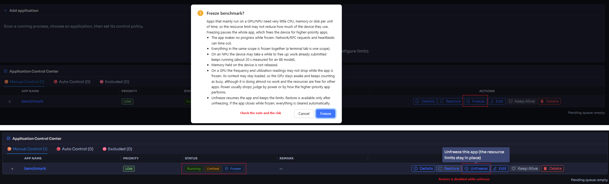
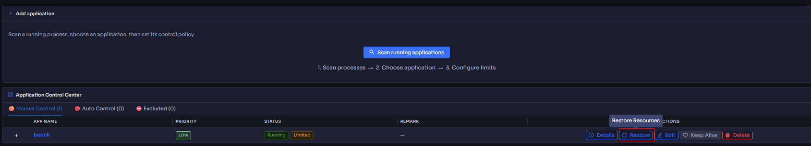
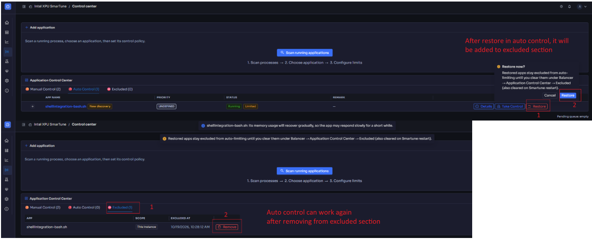

# Control center

[← Back to contents](../README.md)

> Available only on the **full** (`smartune`) install. A monitor-only install
> does not show this tab.

**Purpose:** decide *which apps matter* and *how SmarTune is allowed to manage
them*. This is where automatic balancing meets your intent — you set priority
and optional manual limits here, and SmarTune applies/relaxes cgroup limits as
pressure rises and falls.

<!-- Screenshot: the Control center with a list of controlled apps and their
     status/priority columns. -->

## How automatic control works

Automatic limiting runs only while the **Auto System Control** switch at the top
of the Control center is **on**.

- **When:** [system or disk pressure](home.md) reaches **critical**. At *high*,
  SmarTune only identifies the next target; it does not limit yet.
- **Who:** the app using the most resources right now, one app at a time. This
  includes apps you have not added to the Control center.
- **How hard:** set by the app's **Priority**. The lower the priority, the
  tighter the CPU, memory and disk I/O limits. Apps not in the Control center
  get the tightest limits. **Critical** apps are never auto-limited.
- **Recovery:** as pressure falls, limits are released in **stages** (a gradual
  recovery, not an abrupt lift).

SmarTune also switches the CPU frequency governor by pressure level.

If you turn the switch **off**, apps that are currently auto-limited move to
Manual Control with their limits kept in place. Nothing is released all at
once. Manual limits and network shaping keep working while the switch is off.

## Per-app controls

Each controlled app row shows its live state and exposes controls:

| Column / control | Meaning |
| --- | --- |
| **Status** | Whether the app is currently limited, recovering, or free. |
| **Priority** | One of **Critical / High / Low / System** — higher priority is protected longer and limited last. |
| **CPU / Memory** | Current usage and any active CPU/memory limit. |
| **Disk I/O** | Current I/O and any active throughput/IOPS cap. |
| **Limit Reason** | *Why* a limit is in place (e.g. which pressure channel triggered it). |
| **Staged recovery** | Progress of the gradual limit release as pressure eases. |
| **Scopes (cgroups)** | The cgroup scope(s) this app maps to. |

### Set priority

Change an app's **Priority** to tell SmarTune how hard to protect it. **Critical**
apps are also eligible for [keep-alive](#keep-alive) and are limited last.

### Apply a manual limit

Open an app's limit settings to set your own ceilings instead of relying only on
automatic control:

<!-- Screenshot: the per-app limit settings panel expanded (CPU / Memory / Disk IO). -->

- **CPU Limit** — how much CPU this app may consume.
- **Memory Limit** — a memory ceiling for the app.
- **Disk I/O Limit** — read/write throughput and IOPS caps.
- **Update Network Priority** — the app's network priority class
  (Critical/High/Low/System), used by traffic shaping.

Each field has an inline **Help** tooltip explaining safe ranges. Values are
clamped to hardware-safe limits.

### Keep-alive

For **Critical** apps, enable keep-alive so SmarTune reduces the chance the
system OOM-killer terminates them under memory pressure (via `oom_score_adj`),
while it keeps monitoring the process for stability.

## Freezing an app

Use **Freeze** only when a manual limit is not enough. Apps that mainly run
on a GPU or NPU need very little CPU, memory or disk per unit of time, so the
limit may not reduce how much of the device they use. Freezing pauses the whole
app, which frees the device for higher-priority apps.

Freeze is a separate step after Limit, available on manually limited apps:

- Limit the app first. The row then shows **Restore** and **Freeze**.
- Click **Freeze** and confirm. The app shows a **Frozen** tag next to its limit
  tag, **Restore** is disabled, and **Freeze** becomes **Unfreeze**.
- Click **Unfreeze** to let the app run again; the limits remain. If it fails,
  the button stays, so click it again to retry.
- Once unfrozen, **Restore** is available again and lifts the limits.
- If an app stays frozen for 10 minutes, a reminder appears once, on whichever page you are on, so a forgotten
  freeze does not go unnoticed (`freeze_notify_after`, 0 turns it off).
- If a frozen app closes, its limits and freeze are cleared automatically.

Top: the confirmation dialog shown when you click **Freeze**. Bottom: a frozen app, with the **Frozen** tag next to its limit tag, **Restore** disabled and **Unfreeze** available.

Before you freeze, be aware that:

- The app makes no progress while frozen. Network or RPC requests and
  heartbeats can time out.
- Everything in the same scope is frozen together (a terminal tab is one scope).
- On an NPU the device may take a while to free up: work already submitted keeps
  running (about 20 s measured for an 8B model).
- Memory held on the device is not released.
- On a GPU the frequency and utilization readings may not drop while the app is
  frozen. Its context may stay loaded, so the GPU stays awake and keeps counting
  as busy, although it is doing almost no work and the device is free for other
  apps. Power usually drops; judge by power or by how the higher-priority app
  performs.

If SmarTune stops while an app is frozen, it unfreezes that app the next time it
starts.

## Restoring limits

You are always in control of releasing limits:

- **Restore now** — release a specific active limit immediately instead of
  waiting for staged recovery.
- **Restore Resources** — lift the app's limits back to normal. Unfreeze a
  frozen app first; Restore is disabled until then.

<!-- Screenshot: Restore Resources on a manually limited app (Manual Control tab). -->

## Excluded apps

The **⛔ Excluded** tab lists apps that
[automatic control](#how-automatic-control-works) will skip, even when they
are the heaviest app under critical pressure.

**How an app gets here:** an app is auto-limited and shows up under
**Auto Control**. You choose **Restore** on it. The limit is lifted and the
app is added to Excluded. If you want to keep the limit but manage it yourself,
choose **Take Control** instead. The app then moves to Manual Control with its
current limit and is not added to Excluded.

**What is excluded:** the **Scope** column shows how much is excluded.

- **All instances:** the app is in the Control center, so every process of
  that app is skipped.
- **This instance:** the app is not in the Control center, so only that one
  process (its cgroup) is skipped. Other processes with the same name can
  still be auto-limited.

**Making an app eligible again:** click **Remove** on its row and confirm
**Allow auto-limiting again?**. The next time pressure reaches critical,
automatic control may limit the app again.

<!-- Screenshot: Restore on an auto-limited app adds it to Excluded; Remove
     makes it eligible for auto-limiting again. -->

> The Excluded list is kept in memory only. It is cleared when SmarTune
> restarts.

An app with a manual limit is also skipped by automatic control, but it is not
listed here. It stays under Manual Control until you **Restore Resources** or
the app closes.

## The launch queue

When resources are critically scarce, new launch requests for controlled apps
are **queued** by priority rather than starting immediately and making things
worse. When resources recover, queued apps launch automatically in priority
order.

- You can **Cancel Relaunch** to drop a pending queued launch you no longer want.

---

Related: tune the *policies* behind all of this (thresholds, which controls are
active, network shaping) in **[Settings](settings.md)**, and watch the effect of
every action in **[System diagnostics](diagnostics.md)**.
