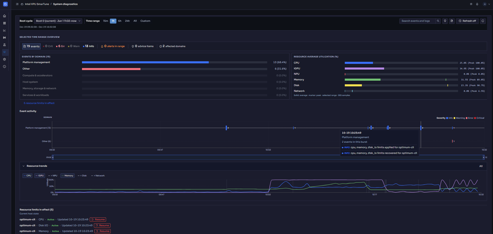
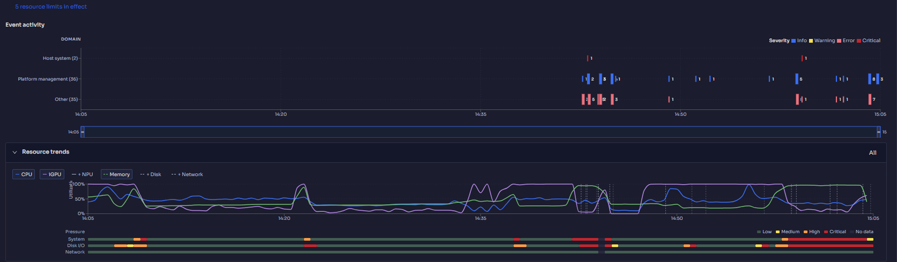
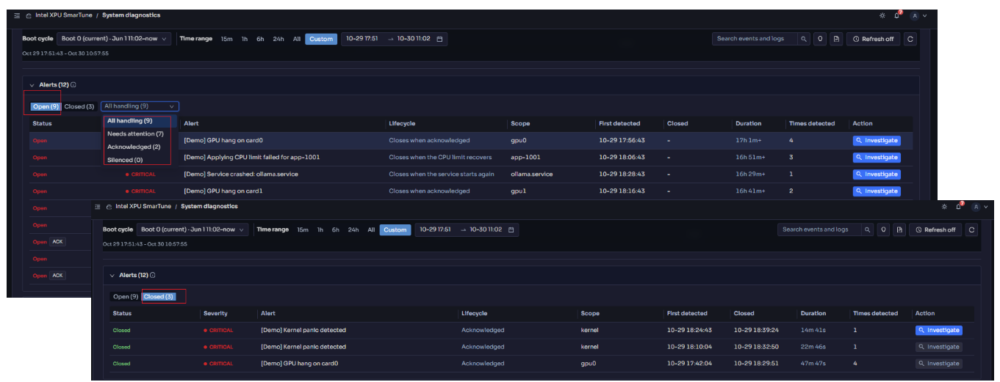
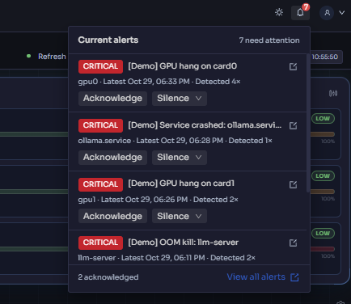
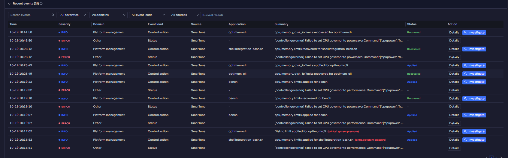
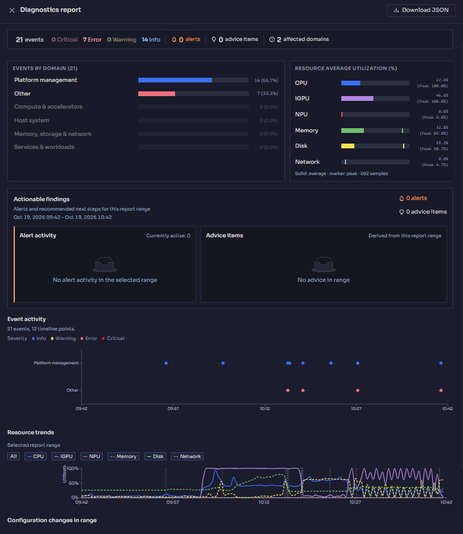

# System diagnostics

[← Back to contents](../README.md)

> Shown only when diagnostics is enabled on the server.

**Purpose:** answer *"what happened, when, and what did SmarTune do about it?"*
Diagnostics turns raw events and logs into a timeline with severity, alerts, and
plain-language **advice**, so you can investigate a slowdown after the fact.

<!-- Screenshot: the full System diagnostics tab — summary cards on top, the
     event timeline in the middle, the event/log tables below. -->

## Picking the time range

Everything on the page is scoped to a time range. You can:

- Select a **boot cycle** to look at one power-on session.
- Arrive pre-scoped from [Home](home.md) or [History](history.md) when you drill
  in from there.
- **Refresh** to pull the latest events.

## Summary panels

Across the top, a set of cards summarize the selected range:

- **Selected time range overview** — the headline counts for the window.
- **Event profile** / **Event severity distribution** — how many events, split by
  severity.
- **Event counts by domain** — which subsystem (CPU, memory, disk, network,
  control, benchmark, …) generated the events.
- **Resource average utilization** — average load over the window, for context.

Cards are actionable — for example, *View alerts active in the selected range*
opens the [Alerts](#alerts) list and scrolls to it, and *View advice items for
the selected range* filters the advice list.

## Event activity timeline

The **event activity timeline** plots events over time, colored by severity (see
the **severity legend**). This is the fastest way to spot a burst of activity.

<!-- Screenshot: the event activity timeline with a visible burst of events. -->

- **Zoom** into a span to narrow the range, and **Reset zoom** to go back.
- **Resource trends**, below the timeline, plots CPU, GPU, NPU, memory, disk and
  network utilization on the same time axis, with each event marked as a dashed
  line. Click a resource in its legend to show or hide it.
- **Pressure** lanes under the chart show the **System**, **Disk I/O** and
  **Network** pressure level over the same span — green *low*, yellow *medium*,
  orange *high*, red *critical*; grey means no samples. Each span shows the worst
  level reached in it, so a short spike is not averaged away. Hover a span for its
  level and time range. Use the lanes to see whether a burst of events or a
  utilization peak came with real contention: pressure, not utilization, is what
  triggers automatic control.

## Alerts

An **alert** is a problem that may need you to act. Alerts are *derived from
events*, but only a fixed set of event types creates one:

| Event type | Severity | What closes the alert |
|---|---|---|
| `PLATFORM_KERNEL_PANIC` | critical | Acknowledging it |
| `RESOURCE_MEMORY_OOM_KILL` | critical | Acknowledging it. Raised for the kernel OOM killer and for systemd-oomd |
| `PLATFORM_HOST_UNCLEAN_SHUTDOWN` | error | Acknowledging it. Raised once per boot when the previous one ended without a clean shutdown (crash, hang, reset or power loss) |
| `DEVICE_GPU_HANG` | critical | Acknowledging it |
| `PLATFORM_KERNEL_OOPS` | critical | Acknowledging it |
| `PLATFORM_KERNEL_LOCKUP` | critical | Acknowledging it |
| `DEVICE_HARDWARE_ERROR_UNCORRECTED` | critical | Acknowledging it |
| `PLATFORM_KERNEL_HUNG_TASK` | error | Acknowledging it |
| `DEVICE_STORAGE_IO_ERROR` | error | Acknowledging it |
| `DEVICE_GPU_THROTTLED` | warning | The GPU stops being throttled (confirmed over 3 consecutive samples) |
| `PLATFORM_SERVICE_CRASHED` | critical | Acknowledging it. Raised for an uncaught exception, or at the next start when the previous run ended without shutting down (killed, OOM-killed, crashed in native code) |
| `PLATFORM_SYSTEMD_RESTART_LOOP` | error | 5 minutes without a new detection. A loop is recorded at most once a minute per unit; it escalates to critical when the restart counter reaches 10 or after 3 detections in 5 minutes |
| `CONTROL_CPU_LIMIT_FAILED` | error | Acknowledging it, or a reboot |
| `CONTROL_MEMORY_LIMIT_FAILED` | error | Acknowledging it, or a reboot |
| `CONTROL_DISK_IO_LIMIT_FAILED` | error | Acknowledging it, or a reboot |
| `LOG_ERROR_SIGNATURE_BURST` | error | 10 minutes without a new detection |
| `CUSTOM_RULE::<id>` | the rule's severity | Set per rule: acknowledging it, or the rule not matching for its quiet period. Only rules whose **Alert** setting is on |

**Errors without a rule.** You do not need a rule for every error message.
SmarTune reads every error-level line from its own logs and from the system
journal (any service, plus the kernel). It reduces each line to a template:
numbers, ids, paths, addresses and quoted values become placeholders, so
`Cannot read private key file /etc/xrdp/key.pem` and the same message with
another path are one template. For each template it records when it was
first and last seen and how often it occurs, and records:

- **New error** (`LOG_ERROR_SIGNATURE_NEW`): a template never seen before on
  this host. It is an event, not an alert: evidence to look at when you (or an
  agent) investigate. An error that keeps recurring at its usual rate, for
  example a unit that fails every hour, is reported once and then stays quiet.
- **Error burst** (`LOG_ERROR_SIGNATURE_BURST`, an alert): a template occurs at least 10
  times in 5 minutes *and* at least 5 times more often than its own history
  predicts. It is recorded at most every 5 minutes per component while the
  burst lasts, and the alert closes 10 minutes after the burst ends.

Lines already recognised by a built-in rule (OOM kill, kernel fault, restart
loop, …) or matched by one of your custom rules are not counted again. To
limit noise, during the first hour after installation (restarts included) and
the first minutes of the first boot after it, existing errors are learned
without events. At most 10 new-error events are recorded per hour: the next one
reports how many were held back, and a held-back error is reported when it
occurs again. When systemd reports a failing unit, the unit counts as the
component, so bursts from two failing services are two alerts. Both event types can be
turned off in **Settings → Diagnostic events**.

**Custom rules can alert.** A rule's message phrase needs at least 3 characters
(spaces at either end are ignored): shorter ones match nearly every line. In
**Settings → Custom diagnostic rules**, set a
rule's **Alert** to *Alert until acknowledged* (one-off faults) or *Alert until
quiet* (the alert closes after the rule has not matched for the quiet period,
1 to 1440 minutes, default 10). The alert uses the rule's severity, which must
be warning or higher. Repeated matches fold into one open alert. Changes apply
without a restart. If you delete a rule or turn its alert off, its open alerts
close when acknowledged.

Every other event stays
diagnostic evidence only, even when its severity is error or critical. That
includes kernel WARNs (`PLATFORM_KERNEL_WARNING`), process crashes
(`PLATFORM_PROCESS_CRASHED`), corrected hardware errors
(`DEVICE_HARDWARE_ERROR_CORRECTED`) and CPU thermal throttling
(`DEVICE_CPU_THERMAL_THROTTLED`): they are frequent enough that alerting on
each would bury real faults, so they feed **Advices** instead. Repeats of the
same kernel fault on the same subject (a task re-reported every two minutes, a
storm of corrected PCIe errors) are recorded a few times per 10 minutes, and
each recorded event carries `occurrences` and `suppressed_since_last` counts. The ⓘ
icon next to the **Alerts** heading shows this **Alert policy** in the
dashboard.

**Open and Closed.** An alert is **Open** while someone may still need to act,
and **Closed** once whatever ends it has happened (see the table above). The
"Acknowledging it" types are one-off faults with no recovery signal, so
**acknowledging them is what closes them** — investigate first, then
acknowledge.

**Repeats are merged.** Repeated detections of the same event type in the same
scope (app, service, control lifecycle, …) are grouped into one alert and
counted in **Times detected**, instead of raising new alerts; the bell lists
each open alert once. If the alert fires again after it has closed, that is a
new occurrence with its own row.

**New alerts pop up.** When an alert opens, a notification appears on whichever
dashboard tab you have open, with **Open Alerts** to go to it; a critical one
stays until you dismiss it. Further detections of an open alert notify at most
once every 5 minutes; an acknowledged or silenced alert does not notify again.
An escalation notifies at once, even inside those 5 minutes, and needs
attention again even if the alert was acknowledged. (In
monitor-only mode the bell picks new alerts up within 30 seconds instead.)

**Event, alert and advice severity.** One incident can show three severity
levels, because each answers a different question:

- An **event's** severity is set by whatever reported it and describes that
  one observation. For example, the kernel log line of an OOM kill is recorded
  as *error*.
- An **alert's** severity comes from its alert policy (the table above) and says
  how urgently someone should act: an OOM kill alert is *critical*. An
  escalation rule can raise it while the alert is open (a restart loop that goes
  on becomes *critical*); its details then show why.
- An **advice** item's severity is set by the rule that produced it, which weighs
  all the evidence in the window together.

The event list, the timeline and the severity counts use event severities; the
Alerts list, the bell and notifications use alert severities.

**When detection is blind.** If SmarTune cannot read the system journal or its
own logs (for example, journal access is denied), a warning at the top of the
page says so and since when: faults from that source are not being detected
until it can be read again.

<!-- Screenshot: the Alerts section — Open/Closed switch, handling filter, and
     the alert table with at least one open and one closed alert. -->

### The Alerts list

The **Alerts** section lists every alert that was open at some point in the
selected time range:

- Switch between **Open** and **Closed**.
- For open alerts, filter by how they are being handled: **Needs attention**,
  **Acknowledged**, or **Silenced**.
- Columns show the **Status** (with `ACK` / `SILENCED` marks), **Severity**,
  **Scope**, **First detected**, **Closed**, **Duration**, **Times detected**,
  and a **Lifecycle** hint — for an open alert, what will close it; for a closed
  one, what closed it.
- **Investigate** opens the investigation view for the event behind the alert.
- **Close** (open alerts) closes an alert by hand, whatever normally closes it.
  Use it when the problem is over but its recovery was never recorded — for
  example GPU throttling that ended while SmarTune was restarting, or a device
  that is gone. If the fault is detected again, a new alert opens. A closed
  alert's **Lifecycle** then reads *Closed manually*; a failed resource limit
  from an earlier boot is closed at startup and reads *Cleared by reboot*.
- If the selected range ends in the past and newer alerts have opened since, a
  hint offers **Jump to now**.

In the **event list**, events that create alerts carry an `ALERT · OPEN` or
`ALERT · CLOSED` tag in the Summary column, so you can see whether the alert the
event belongs to is still open. Hover a closed tag to see when and why it
closed. A plain `ALERT` tag means the event is of an alerting type, but its
alert is not in the loaded alert list.

### Acknowledge and silence

Handle current alerts from the **Current alerts** panel behind the bell icon in
the header (see [Getting started](getting-started.md#4-a-tour-of-the-dashboard)):

- **Acknowledge** — you've seen it. For the one-off faults (the types closed by
  "Acknowledging it" in the table above) this also **closes** the alert; for the
  other types it only marks the alert as being handled, and it stays open until
  its recovery condition is met.
- **Silence** — stop notifications for **30 minutes** or **2 hours**.

An acknowledgement applies to the current occurrence only: if the alert fires
again after closing, or its severity is escalated, it needs attention again. A
silence lasts until it runs out, even if the alert closes and fires again in
between, so an alert that keeps flapping stays quiet for the time you chose.

Select an alert in the panel to jump here with the page centered on that alert's
time span; **View all alerts** opens the Alerts list scoped to a range ending
now.

<!-- Screenshot: the Current alerts panel opened from the bell icon. -->

## Events and logs

Below the alerts are the detailed tables.

**Events.** Search and filter the event list by **severity**, **domain**,
**kind**, and **source**. Select **Details** on any row for the full context of
that event, or **Investigate** to open the investigation view, which also lists
the **Alerts in window** — every alert open during that window, including ones
that have since closed.

<!-- Screenshot: the event list, including a row with an ALERT tag. -->

**Logs.** Search log messages within the selected range and filter by **log
level** and **log source**.

> On SmarTune, logs stay on the single machine and are not written to journald;
> alerts are *derived from events*, so what you see here is self-contained to
> this host.

## Advice

The **Advices** view lists expert, plain-language recommendations derived from
what happened — e.g. which app to re-prioritize, or which limit is worth
revisiting. From a diagnostics context you can also take direct action, such as
**Restore all active limits for an application**.

## Export a report

Use **Diagnostics report** to **download the complete report as JSON** for the
selected range — handy for sharing an investigation or attaching to a bug. Its
**Alert activity** card covers every alert that was open at some point in the
range, including ones that have since closed.

<!-- Screenshot: the Diagnostics report export control / dialog. -->

---

Next: **[History](history.md)** — longer-term trends behind these events.
