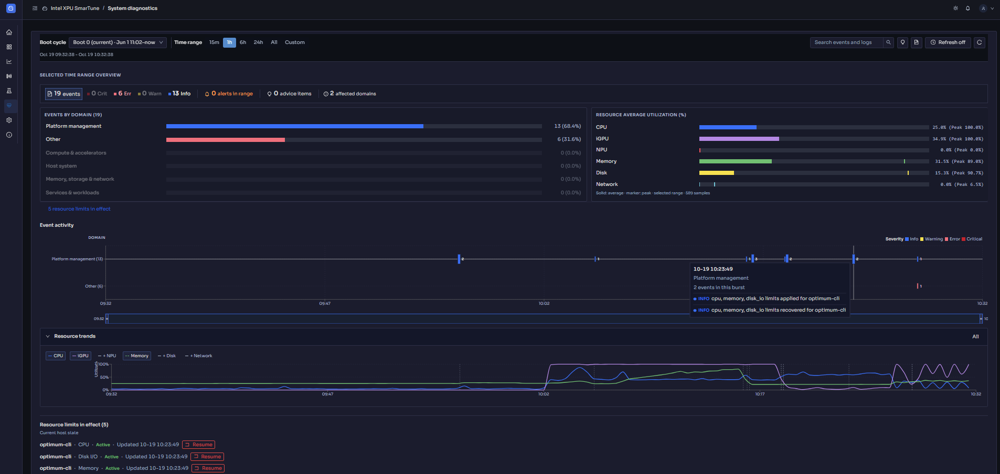
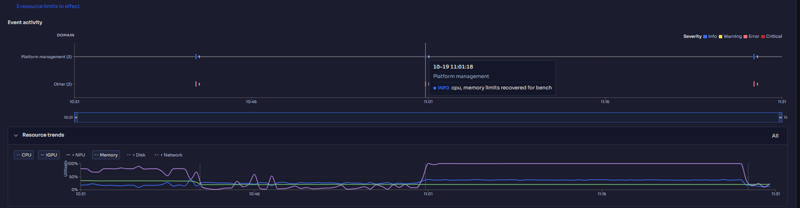
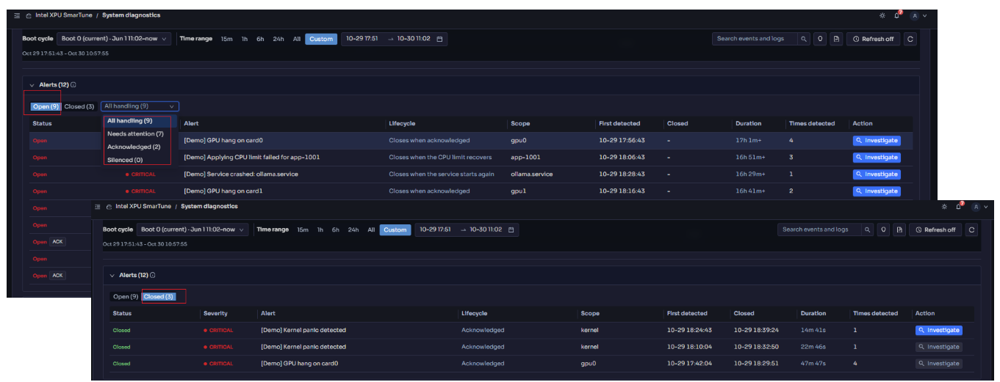
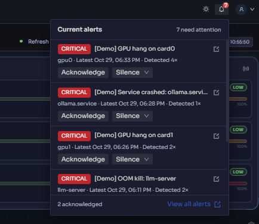
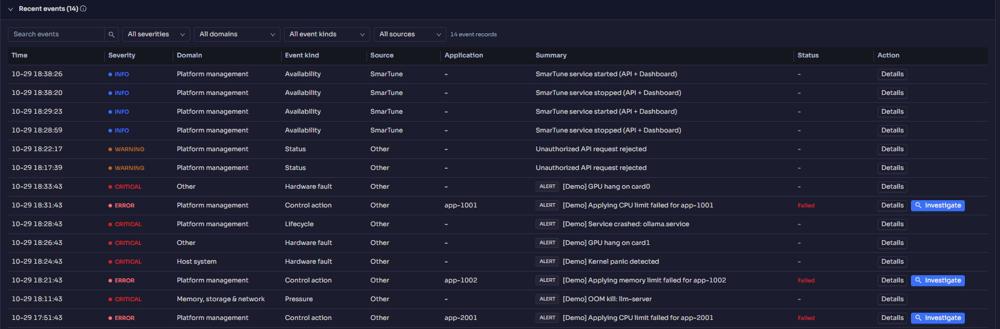
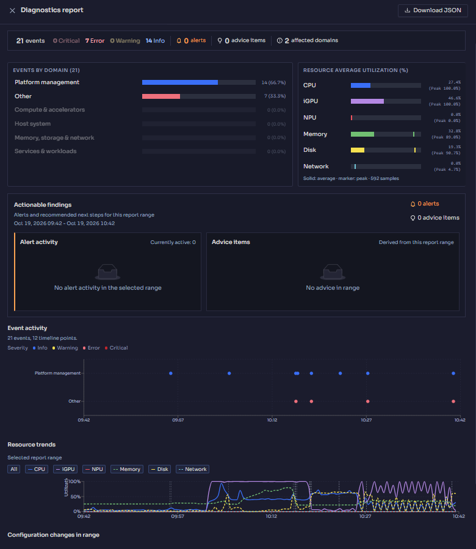

# System diagnostics

[← Back to contents](../README.md)

> Shown only when diagnostics is enabled on the server.

**Purpose:** answer *"what happened, when, and what did SmarTune do about it?"*
Diagnostics turns raw events and logs into a timeline with severity, alerts, and
plain-language **advice**, so you can investigate a slowdown after the fact.

<!-- Screenshot: the full System diagnostics tab — summary cards on top, the
     event timeline in the middle, the event/log tables below. -->

## Picking the time range

Everything on the page is scoped to a time range. You can:

- Select a **boot cycle** to look at one power-on session.
- Arrive pre-scoped from [Home](home.md) or [History](history.md) when you drill
  in from there.
- **Refresh** to pull the latest events.

## Summary panels

Across the top, a set of cards summarize the selected range:

- **Selected time range overview** — the headline counts for the window.
- **Event profile** / **Event severity distribution** — how many events, split by
  severity.
- **Event counts by domain** — which subsystem (CPU, memory, disk, network,
  control, benchmark, …) generated the events.
- **Resource average utilization** — average load over the window, for context.

Cards are actionable — for example, *View alerts active in the selected range*
opens the [Alerts](#alerts) list and scrolls to it, and *View advice items for
the selected range* filters the advice list.

## Event activity timeline

The **event activity timeline** plots events over time, colored by severity (see
the **severity legend**). This is the fastest way to spot a burst of activity.

<!-- Screenshot: the event activity timeline with a visible burst of events. -->

- **Zoom** into a span to narrow the range, and **Reset zoom** to go back.

## Alerts

An **alert** is a problem that may need you to act. Alerts are *derived from
events*, but only a fixed set of event types creates one:

| Event type | Severity | What closes the alert |
|---|---|---|
| `PLATFORM_KERNEL_PANIC` | critical | Acknowledging it |
| `RESOURCE_MEMORY_OOM_KILL` | critical | Acknowledging it |
| `DEVICE_GPU_HANG` | critical | Acknowledging it |
| `PLATFORM_SERVICE_CRASHED` | critical | The same service starts again |
| `PLATFORM_SYSTEMD_RESTART_LOOP` | error | 2 minutes without a new detection (escalates to critical when detected 3 times in 5 minutes) |
| `CONTROL_CPU_LIMIT_FAILED` | error | The CPU limit recovers |
| `CONTROL_MEMORY_LIMIT_FAILED` | error | The memory limit recovers |
| `CONTROL_DISK_IO_LIMIT_FAILED` | error | The disk I/O limit recovers |

Every other event — including events from your own custom rules — stays
diagnostic evidence only, even when its severity is error or critical. The ⓘ
icon next to the **Alerts** heading shows this **Alert policy** in the
dashboard.

**Open and Closed.** An alert is **Open** while someone may still need to act,
and **Closed** once whatever ends it has happened (see the table above). The
first three types are one-off faults with no recovery signal, so
**acknowledging them is what closes them** — investigate first, then
acknowledge.

**Repeats are merged.** Repeated detections of the same event type in the same
scope (app, service, control lifecycle, …) are grouped into one alert and
counted in **Times detected**, instead of raising new alerts. Notifications for
the same alert are sent at most once every 5 minutes. If the alert fires again
after it has closed, that is a new occurrence with its own row.

<!-- Screenshot: the Alerts section — Open/Closed switch, handling filter, and
     the alert table with at least one open and one closed alert. -->

### The Alerts list

The **Alerts** section lists every alert that was open at some point in the
selected time range:

- Switch between **Open** and **Closed**.
- For open alerts, filter by how they are being handled: **Needs attention**,
  **Acknowledged**, or **Silenced**.
- Columns show the **Status** (with `ACK` / `SILENCED` marks), **Severity**,
  **Scope**, **First detected**, **Closed**, **Duration**, **Times detected**,
  and a **Lifecycle** hint — for an open alert, what will close it; for a closed
  one, what closed it.
- **Investigate** opens the investigation view for the event behind the alert.
- If the selected range ends in the past and newer alerts have opened since, a
  hint offers **Jump to now**.

In the **event list**, events that create alerts carry an `ALERT · OPEN` or
`ALERT · CLOSED` tag in the Summary column, so you can see whether the alert the
event belongs to is still open. Hover a closed tag to see when and why it
closed. A plain `ALERT` tag means the event is of an alerting type, but its
alert is not in the loaded alert list.

### Acknowledge and silence

Handle current alerts from the **Current alerts** panel behind the bell icon in
the header (see [Getting started](getting-started.md#4-a-tour-of-the-dashboard)):

- **Acknowledge** — you've seen it. For kernel panic, OOM kill, and GPU hang
  this also **closes** the alert; for the other types it only marks the alert as
  being handled, and it stays open until its recovery condition is met.
- **Silence** — stop notifications for **30 minutes** or **2 hours**.

Acknowledge and silence apply to the current occurrence only: if the alert
fires again after closing, or its severity is escalated, it needs attention
again.

Select an alert in the panel to jump here with the page centered on that alert's
time span; **View all alerts** opens the Alerts list scoped to a range ending
now.

<!-- Screenshot: the Current alerts panel opened from the bell icon. -->

## Events and logs

Below the alerts are the detailed tables.

**Events.** Search and filter the event list by **severity**, **domain**,
**kind**, and **source**. Select **Details** on any row for the full context of
that event, or **Investigate** to open the investigation view, which also lists
the **Alerts in window** — every alert open during that window, including ones
that have since closed.

<!-- Screenshot: the event list, including a row with an ALERT tag. -->

**Logs.** Search log messages within the selected range and filter by **log
level** and **log source**.

> On SmarTune, logs stay on the single machine and are not written to journald;
> alerts are *derived from events*, so what you see here is self-contained to
> this host.

## Advice

The **Advices** view lists expert, plain-language recommendations derived from
what happened — e.g. which app to re-prioritize, or which limit is worth
revisiting. From a diagnostics context you can also take direct action, such as
**Restore all active limits for an application**.

## Export a report

Use **Diagnostics report** to **download the complete report as JSON** for the
selected range — handy for sharing an investigation or attaching to a bug. Its
**Alert activity** card covers every alert that was open at some point in the
range, including ones that have since closed.

<!-- Screenshot: the Diagnostics report export control / dialog. -->

---

Next: **[History](history.md)** — longer-term trends behind these events.
