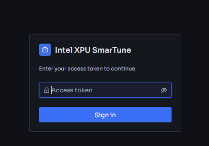
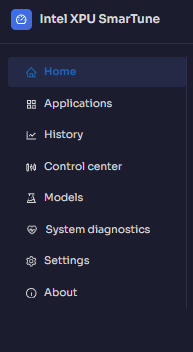

# Getting started

[← Back to contents](../README.md)

This page takes you from a fresh machine to an open dashboard: requirements, the
three ways to start SmarTune, how to log in, and a quick tour of the dashboard.

## 1. Requirements

- An Intel MTL, PTL, or Wildcat Lake class system running Ubuntu / Debian
  (see the [Install guide](../install.md) for verified platforms and versions).
- A local administrator account — SmarTune needs root privileges to read
  hardware telemetry and apply cgroup limits.
- A modern browser on the same machine (or one that can reach it).

## 2. Install and start SmarTune

There are three ways to run SmarTune — pick **one**. The commands for each live in
the **[Install guide](../install.md)**.

| Way | Best for | Dashboard URL |
| --- | --- | --- |
| **[From source](../install.md#run-from-source)** | development, a quick trial | `http://<host-ip>:39527/` |
| **[From source as a systemd service](../install.md#run-as-a-systemd-service)** | a source install that starts on boot and restarts on failure | `http://<host-ip>:39527/` |
| **[Debian package](../install.md#debian-package)** | end users (self-contained, no dev server) | `https://localhost:9001` |

The Debian package comes in two variants: `smartune-monitor` (Home, Applications,
History, Settings, About) and the full `smartune` (all of those **plus** Control
center, and Models / System diagnostics when enabled).

From source, the dashboard dev server binds `0.0.0.0` and proxies API calls to
the backend on port 9001, so it is reachable from other machines on the network.
The Debian package serves the dashboard directly; its browser may warn that the
site is **Not Secure** because of the self-signed TLS certificate — confirm the
address and continue.

## 3. Log in

SmarTune has no user name or password. The dashboard (and every API endpoint) is
protected by a single **access token** that the server creates for your instance.
You need that token to sign in.

<!-- Screenshot: the login / sign-in screen (LoginGate). -->


### Debian package: automatic sign-in

When you start SmarTune from the application menu, the launcher reads the token
for you (after the administrator Polkit prompt) and passes it to the browser, so
you normally land straight on the dashboard **without seeing the sign-in screen**.

You only see the sign-in screen if you open `https://localhost:9001` yourself, from
another browser or machine, or after the browser's saved token was cleared.
In that case, get the token as described below.

### From source or systemd service: sign in manually

Open the dashboard and paste the token into the sign-in screen.

1. Get the token. It is stored in a root-only file, so read it with `sudo`:

   ```bash
   sudo cat key/api_token                          # source install (repository root)
   sudo cat /opt/intel/smartune/key/api_token      # Debian package
   ```

   The file is created automatically the first time the service starts
   (random value, mode `0600`) and reused on every later start, so the token does
   not change between restarts.

2. Enter the token in the **Access token** field and select **Sign in** (or press
   Enter). The main dashboard opens.

The browser remembers the token, so you do not have to sign in again on that
browser. If the token is changed on the server, the saved one stops working and
the sign-in screen appears again.

| Message on the sign-in screen | Meaning |
| --- | --- |
| *Please enter your access token.* | The field was empty. |
| *Invalid access token. Please check with your administrator.* | The token is wrong or out of date. Re-read it from `key/api_token`. |
| *Could not reach the server. Please try again.* | The service is not running or not reachable; see [Troubleshooting](troubleshooting.md#the-dashboard-wont-open). |

### Sharing, setting, or resetting the token

- **Share access:** give the token to the people who should use the dashboard.
  Anyone with it has full access, so share it only over a trusted channel.
- **Choose your own token:** set the `BALANCER_API_TOKEN` environment variable
  before starting the service. It takes priority over the file.
- **Reset the token:** stop the service, delete `key/api_token`, and start it
  again; a new random token is generated. Everyone must then sign in with the new
  token.

## 4. A tour of the dashboard

SmarTune uses a left navigation rail. Depending on what the server enables, you
will see some or all of these:

<!-- Screenshot: the left navigation rail expanded, showing all tabs. -->


| Icon / Tab | What it's for | Guide |
| --- | --- | --- |
| 🏠 **Home** | Live platform overview + Pressure Overview | [Home](home.md) |
| 📦 **Applications** | Controlled apps' resource use + all processes | [Applications](applications.md) |
| 📈 **History** | Long-term pressure & utilization trends | [History](history.md) |
| 🎚️ **Control center** *(full only)* | Priority, limits, keep-alive, launch queue | [Control center](control-center.md) |
| 🧪 **Models** *(when enabled)* | Download & benchmark AI models | [Models](models.md) |
| 🩺 **System diagnostics** *(when enabled)* | Event timeline, alerts, logs, advice | [Diagnostics](diagnostics.md) |
| ⚙️ **Settings** | Thresholds, control policies, diagnostic rules | [Settings](settings.md) |
| ℹ️ **About** | Hardware & software inventory | [About](about.md) |

Useful header controls, present on every tab:

- **Theme toggle** — switch between light and dark.
- **Alert bell** — opens the **Current alerts** panel, with a count of the
  alerts that need attention. **Acknowledge** or **Silence** (30 minutes /
  2 hours) an alert right there, select it to see it in
  [System diagnostics](diagnostics.md#alerts), or use **View all alerts**.
- **Collapse rail** — fold the navigation to widen the content area.
- **User menu → Sign out**.

You're ready. Continue with **[Home](home.md)**, or jump to any tab from the
[contents](../README.md).
