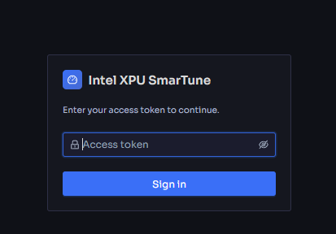
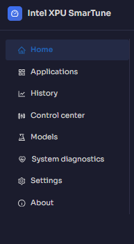

# Getting started

[← Back to contents](../README.md)

This page takes you from a fresh machine to an open dashboard: requirements, the
three ways to start SmarTune, how to log in, and a quick tour of the dashboard.

## 1. Requirements

- An Intel MTL, PTL, or Wildcat Lake class system running Ubuntu / Debian
  (see the [Install guide](../install.md) for verified platforms and versions).
- A local administrator account — SmarTune needs root privileges to read
  hardware telemetry and apply cgroup limits.
- A modern browser on the same machine (or one that can reach it).

## 2. Install and start SmarTune

There are three ways to run SmarTune — pick **one**. The commands for each live in
the **[Install guide](../install.md)**.

| Way | Best for | Dashboard URL |
| --- | --- | --- |
| **[From source](../install.md#run-from-source)** | development, a quick trial | `http://<host-ip>:39527/` |
| **[From source as a systemd service](../install.md#run-as-a-systemd-service)** | a source install that starts on boot and restarts on failure | `http://<host-ip>:39527/` |
| **[Debian package](../install.md#debian-package)** | end users (self-contained, no dev server) | `https://localhost:9001` |

The Debian package comes in two variants: `smartune-monitor` (Home, Applications,
History, Settings, About) and the full `smartune` (all of those **plus** Control
center, and Models / System diagnostics when enabled).

From source, the dashboard dev server binds `0.0.0.0` and proxies API calls to
the backend on port 9001, so it is reachable from other machines on the network.
The Debian package serves the dashboard directly; its browser may warn that the
site is **Not Secure** because of the self-signed TLS certificate — confirm the
address and continue.

## 3. Log in

The dashboard is gated by an access token. On first open you are shown the
sign-in screen; enter the credentials for your SmarTune instance to continue.

<!-- Screenshot: the login / sign-in screen (LoginGate). -->

## 4. A tour of the dashboard

SmarTune uses a left navigation rail. Depending on what the server enables, you
will see some or all of these:

<!-- Screenshot: the left navigation rail expanded, showing all tabs. -->

| Icon / Tab | What it's for | Guide |
| --- | --- | --- |
| 🏠 **Home** | Live platform overview + Pressure Overview | [Home](home.md) |
| 📦 **Applications** | Controlled apps' resource use + all processes | [Applications](applications.md) |
| 📈 **History** | Long-term pressure & utilization trends | [History](history.md) |
| 🎚️ **Control center** *(full only)* | Priority, limits, keep-alive, launch queue | [Control center](control-center.md) |
| 🧪 **Models** *(when enabled)* | Download & benchmark AI models | [Models](models.md) |
| 🩺 **System diagnostics** *(when enabled)* | Event timeline, alerts, logs, advice | [Diagnostics](diagnostics.md) |
| ⚙️ **Settings** | Thresholds, control policies, diagnostic rules | [Settings](settings.md) |
| ℹ️ **About** | Hardware & software inventory | [About](about.md) |

Useful header controls, present on every tab:

- **Theme toggle** — switch between light and dark.
- **Alert / notification bell** — surfaces new diagnostic alerts.
- **Collapse rail** — fold the navigation to widen the content area.
- **User menu → Sign out**.

You're ready. Continue with **[Home](home.md)**, or jump to any tab from the
[contents](../README.md).
