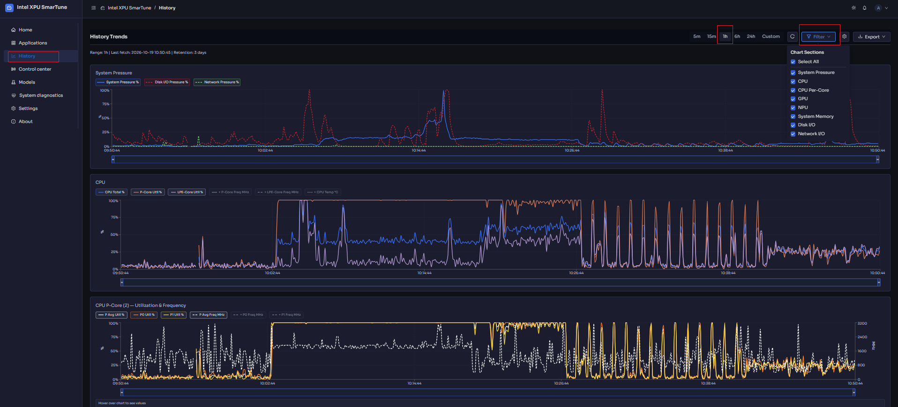
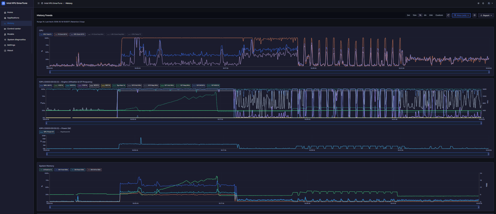

# History

[← Back to contents](../README.md)

**Purpose:** see how the platform behaved **over time**, not just right now.
History plots long-term trends of pressure and resource utilization so you can
spot patterns, recurring spikes, and slow regressions.

<!-- Screenshot: the History tab with a time range selected and several trend
     charts visible. -->

## Choosing what to see

- **Time range** — pick the window to plot. You can also land here pre-scoped
  when you select *Open history* from [Home](home.md).
- **Chart Sections** — choose which trend charts are displayed, so you can focus
  on just CPU and memory, or bring in GPU/NPU.
- **Manual refresh** — force an immediate update.

## The trend charts

Depending on your hardware and selected sections, History shows trends such as:

- **CPU** — utilization and **CPU temperature (°C)**.
- **System Memory** — usage over time.
- **GPU** — frequency, power, and engine utilization trends.
- **NPU** — two charts: *Utilization & Frequency*, and *Power, DDR Bandwidth &
  Temperature*.
- **Disk** and **Network** throughput.
- **Pressure** — the system/disk/network pressure scores over time.

<!-- Screenshot: a close-up of one or two trend charts (e.g. CPU + Memory). -->

## Data retention

History is stored locally and kept for a bounded window.

- **History Data Retention** shows how long data is kept.
- **Retention settings** lets you adjust the retention period (older data is
  pruned beyond it).

> Benchmark KPIs and diagnostic events are also subject to a retention window —
> if you need to keep a result permanently, export it (see
> [System diagnostics → Export a report](diagnostics.md#export-a-report)).

---

Next: **[Settings](settings.md)** — tune the thresholds and policies behind the
numbers.
