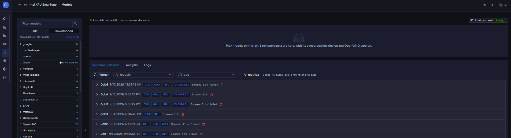
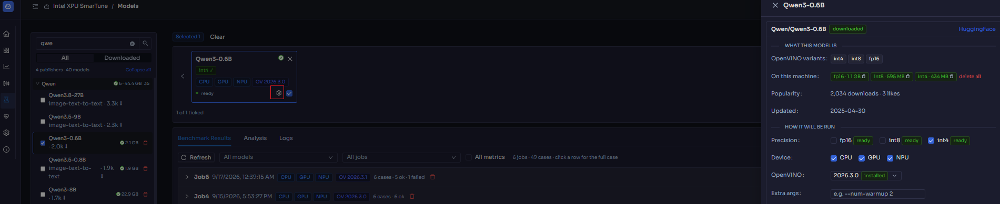
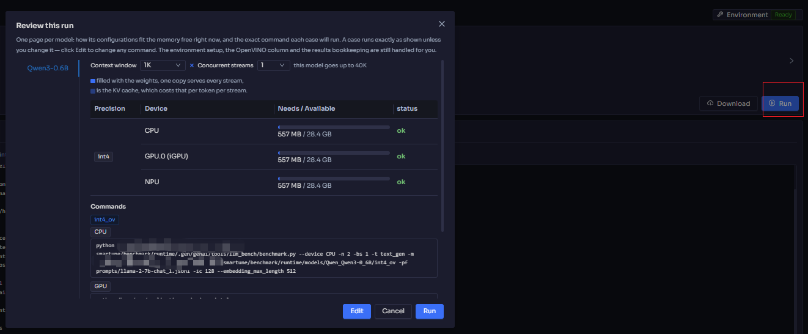

# Models (Benchmark)

[← Back to contents](../README.md)

> Shown only when benchmarking is enabled on the server.

**Purpose:** find out how well AI models actually run **on this hardware**.
SmarTune lets you download models, benchmark them (OpenVINO and GenAI
pipelines), read the recorded KPIs, and compare runs side by side.

<!-- Screenshot: the Models tab showing the model catalog / tiles and the job
     list. -->

## 1. Browse and download models

The model catalog lists available models grouped by publisher. For each model you
can see whether its weights are already **downloaded** and how much disk they
take.

- **Select** a model to work with it.
- **Download** its weights when they aren't present yet.
- **Delete downloaded weights** to free disk space when you're done.

Use the search box to find a model by name across the catalog.

<!-- Screenshot: the model detail / download panel for a single model. -->

## 2. Check that it fits

Before a run, SmarTune helps you avoid wasted time:

- A **memory fit** panel indicates whether the model is likely to fit in
  available memory/VRAM.
- A **disk preflight** check warns if there isn't enough disk space for weights
  or results.

## 3. Run a benchmark

Start a benchmark job for the selected model. A job typically has two phases:

1. **Environment setup** — preparing the runtime/dependencies for the run.
2. **Run** — executing the benchmark and sampling metrics.

Progress and live output are shown while the job runs; you'll also get a
notification when a job finishes.

<!-- Screenshot: a benchmark job running, with its live output. -->

## 4. Read the results

Finished jobs produce **results** with the KPIs the pipeline recorded — the
OpenVINO runtime used, throughput/latency metrics, and the run's status (or a
**failure reason** if it didn't complete).

> **Results persist independently of jobs.** A run's KPIs are frozen into its
> diagnostic event, so the numbers remain visible even after you delete the job
> that produced them — subject to the diagnostics retention window.

## 5. Compare runs

Use the **compare** view to put multiple runs next to each other — for example,
the same model at different precisions, or the same model on different devices —
and see which configuration wins on your hardware.

## Housekeeping

- **Delete a job** — removes the job and every result it produced.
- **Delete downloaded weights** — frees disk without removing the model from the
  catalog.

---

Next: **[System diagnostics](diagnostics.md)** — where benchmark runs also show
up on the event timeline alongside everything else that happened.
