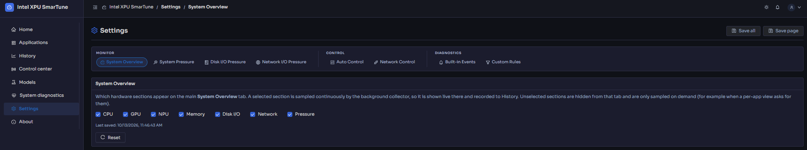
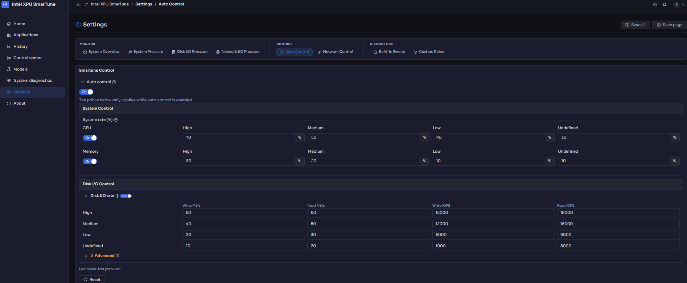
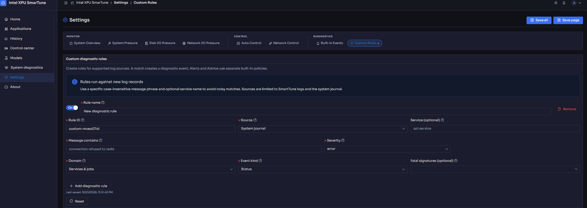

# Settings

[← Back to contents](../README.md)

**Purpose:** tune *how* SmarTune monitors and controls the platform — which
resources are shown, when pressure counts as "high," which controls are active,
and which log patterns become diagnostic events.

Settings is organized into sections. Most pages have a **basic** view and an
**advanced** toggle for finer parameters. Unsaved edits are flagged so you don't
navigate away by accident.

<!-- Screenshot: the Settings panel open on the System pressure section. -->

## System Overview

Choose which resource cards appear on [Home](home.md) (CPU, memory, GPU, NPU,
disk, network). Hide what your platform doesn't have.

## System pressure

Tune the composite [system pressure](home.md) score:

- **Update interval (s)** — how often pressure is sampled.
- **CPU busy threshold (%)** and **Memory busy threshold (%)** — when each input
  starts contributing to pressure.
- **Memory gate steepness** — how sharply memory scarcity ramps the score.

## Disk I/O pressure

Tune the independent disk channel:

- **Sigmoid steepness** — how sharply disk saturation ramps its score.
- **Worst-disk weight** — how much the busiest disk dominates the score.

## Network I/O pressure

Tune network pressure inputs such as the **RX drop weight**.

> The math behind all three channels is documented in the
> [Pressure algorithm deep dive](../design/pressure-algorithm.md).

## SmarTune Control

Enable or disable each control subsystem and set its policy:

- **System Control** — automatic CPU/memory limiting and governor switching.
- **Disk I/O Control** — the `io.max` throttling policy.
- **Network I/O Control** — traffic shaping, including:
  - **Auto network control** — let SmarTune shape traffic automatically.
  - **Per-app packet flood protection** — guard against a single app flooding
    the NIC, with a **candidate threshold (PPS)**, **per-app cap (PPS)**, and
    **burst (packets)**.

<!-- Screenshot: the SmarTune Control section with the three control subsystems. -->

## Diagnostic events & custom rules

- **Built-in diagnostic events** — review the events SmarTune recognizes
  out of the box.
- **Custom diagnostic rules** — teach SmarTune to raise an event when a log line
  matches a pattern you define. A rule has a **name**, **ID**, **source**,
  optional **service**, a **"message contains"** string, a **severity**,
  **domain**, **event kind**, and optional **fatal signatures**.

<!-- Screenshot: the Custom diagnostic rules editor with one rule filled in. -->

These rules drive what appears in [System diagnostics](diagnostics.md).

---

Next: **[About](about.md)** — the platform's hardware and software inventory.
