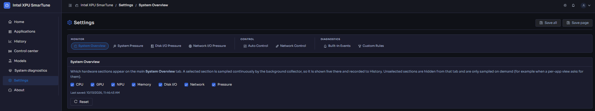
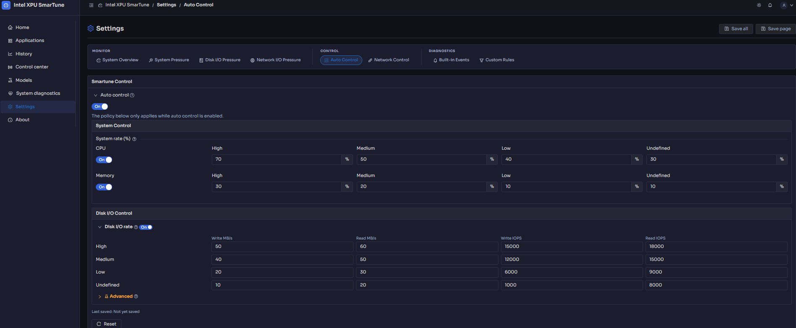
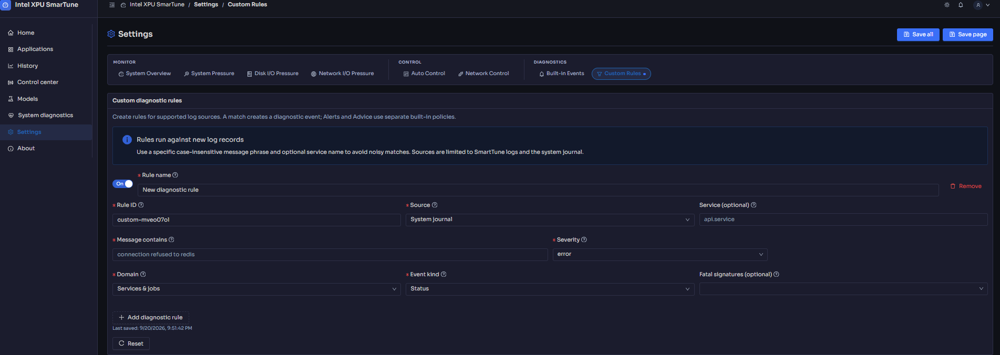

# Settings

[← Back to contents](../README.md)

**Purpose:** tune *how* SmarTune monitors and controls the platform — which
resources are shown, when pressure counts as "high," which controls are active,
and which log patterns become diagnostic events.

Settings is organized into sections. Most pages have a **basic** view and an
**advanced** toggle for finer parameters. Unsaved edits are flagged so you don't
navigate away by accident. Under each numeric field you will see its startup
default, a suggested step, and what raising or lowering the value does (see
[Field guidance and presets](#field-guidance-and-presets)).

<!-- Screenshot: the Settings panel open on the System pressure section. -->

## Field guidance and presets

Most parameters are numbers that are hard to pick blindly, so each one carries
guidance directly under the input box:

- **`Default … · step …`** — the value the backend started with, and a suggested
  step for adjusting it.
- **↑ / ↓ lines** — what happens when you raise or lower the value.
- **Notes** — constraints and risks (for example, a Worst-disk weight below about
  0.8 can stop `io.max` from ever triggering on multi-disk machines), and **when a
  change takes effect** where it is not immediate.

In tables of identical fields (bandwidth min/max, disk rates, per-disk
adjustment, minimum app I/O) each cell shows only its default, and the ↑ / ↓
explanation appears once below the table.

Four fields are **dropdown presets** because raw numbers are hard to reason about:
*Update interval*, *Memory gate steepness*, *Sigmoid steepness* and *Worst-disk
weight*. Pick a named level, or choose **Custom…** to type a value. A stored value
that matches no level is shown as Custom rather than snapped to the nearest one.

## Saving, resetting and restoring defaults

- **Save all** (page header) writes every page with unsaved edits.
- **Reset**, **Restore startup defaults** and **Save page** sit at the bottom right
  and act on the page in view.
- **Reset** discards unsaved edits and reloads the saved values.
- **Restore startup defaults** fills the form with the values the backend started
  with. Nothing is saved until you press **Save page**. It does not touch network
  interface selection, controlled system ports, the Auto control master switch, or
  diagnostic rules.

Saved changes take effect immediately, are written to `config.yaml`, and are
visible to every connected client. After the backend restarts, the saved values
become the new startup defaults.

## System Overview

Choose which resource cards appear on [Home](home.md) (CPU, memory, GPU, NPU,
disk, network). Hide what your platform doesn't have.

## System pressure

Tune the composite [system pressure](home.md) score:

- **Update interval (s)** — how often pressure is sampled.
- **CPU busy threshold (%)** and **Memory busy threshold (%)** — when each input
  starts contributing to pressure.
- **Memory gate steepness** — how sharply memory scarcity ramps the score.
- **Level thresholds** — step 5; they must stay in increasing order.
- **Resource weights** (advanced) — plain numbers for CPU, memory and I/O; only
  the ratio between them matters.

## Disk I/O pressure

Tune the independent disk channel:

- **Sigmoid steepness** — how sharply disk saturation ramps its score.
- **Worst-disk weight** — how much the busiest disk dominates the score.

## Network I/O pressure

Tune network pressure inputs such as the **RX drop weight**.

> The math behind all three channels is documented in the
> [Pressure algorithm deep dive](../design/pressure-algorithm.md).

## SmarTune Control

Enable or disable each control subsystem and set its policy:

- **System Control** — automatic CPU/memory limiting and governor switching.
- **Disk I/O Control** — the `io.max` throttling policy.

> Changed limit rates apply the next time a limit is set. Limits already in force
> keep their old value until the next limit or restore step.

- **Network I/O Control** — traffic shaping, including:
  - **Auto network control** — let SmarTune shape traffic automatically.
  - **Per-app packet flood protection** — guard against a single app flooding
    the NIC, with a **candidate threshold (PPS)**, **per-app cap (PPS)**, and
    **burst (packets)**.

<!-- Screenshot: the SmarTune Control section with the three control subsystems. -->

## Diagnostic events & custom rules

- **Built-in diagnostic events** — review the events SmarTune recognizes
  out of the box.
- **Custom diagnostic rules** — teach SmarTune to raise an event when a log line
  matches a pattern you define. A rule has a **name**, **ID**, **source**,
  optional **service**, a **"message contains"** string, a **severity**,
  **domain**, **event kind**, and optional **fatal signatures**.

<!-- Screenshot: the Custom diagnostic rules editor with one rule filled in. -->

These rules drive what appears in [System diagnostics](diagnostics.md).

---

Next: **[About](about.md)** — the platform's hardware and software inventory.
